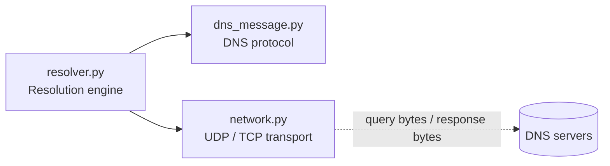
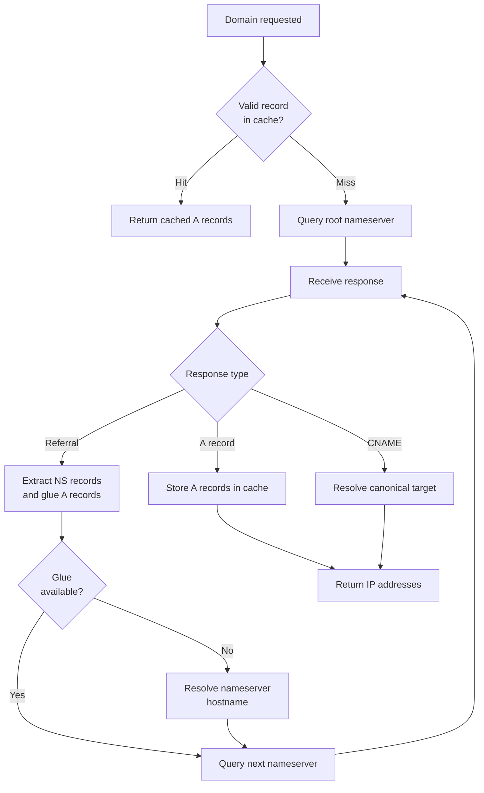

# Pyresolver

An iterative DNS resolver built from scratch in Python. Pyresolver constructs and parses DNS messages at the byte level and performs lookups by communicating directly with DNS servers, following referrals from the root servers through TLD servers to the authoritative nameserver. It does not use any DNS resolution library and does not forward queries to an upstream recursive resolver such as 8.8.8.8.

## Overview

- Iterative resolution starting from a root server (`198.41.0.4`)
- DNS messages built and parsed manually with `struct`
- Queries for IPv4 `A` records, class `IN`, with recursion desired (RD) set to 0
- UDP on port 53 by default, with TCP fallback for truncated responses
- CNAME resolution, in-memory TTL-based caching, retries, and nameserver failover
- Standard library only

## Architecture

The project is split into three modules with distinct responsibilities.



| Module | Responsibility |
|---|---|
| `resolver.py` | Iterative resolution, referral processing, glue handling, nameserver hostname resolution, CNAME handling and loop detection, caching, RCODE handling, nameserver failover |
| `dns_message.py` | DNS header, question and query construction; domain name encoding and decoding (including compression pointers); flag decoding; resource record parsing; A, NS and CNAME decoding; Answer, Authority and Additional section parsing; response validation |
| `network.py` | UDP transport with configurable timeout, retries and exponential backoff; sender IP and port validation; TCP transport for truncated responses |

## Folder Structure

```text
dns_resolver/
├── resolver.py
├── dns_message.py
├── network.py
├── tests/
│   ├── test_parser.py
│   ├── test_cache.py
│   ├── test_failover.py
│   ├── test_tcp_fallback.py
│   └── test_network.py
└── benchmarks/
    └── benchmark_resolver.py
```

| Path | Description |
|---|---|
| `resolver.py`, `dns_message.py`, `network.py` | The three core modules |
| `tests/` | Unit tests built on `unittest` and `unittest.mock` |
| `benchmarks/` | Script for timing DNS resolution across multiple runs and domains |

## DNS Resolution Workflow



1. The resolver checks the in-memory cache. Valid records are returned immediately.
2. On a cache miss, it queries a root server. The root responds with a referral to the TLD nameservers.
3. The TLD servers respond with a referral to the authoritative nameservers. NS records are read from the Authority section and matched against glue A records in the Additional section.
4. If no glue record is available for a nameserver, the resolver resolves that nameserver's hostname itself, with a depth limit and circular lookup detection.
5. The authoritative nameserver returns either an A record, which is cached and returned, or a CNAME record, in which case the canonical target is resolved.

### Query configuration

| Setting | Value |
|---|---|
| Root server | `198.41.0.4` |
| Record type / class | `A` / `IN` |
| Recursion desired | 0 (iterative) |
| Transaction ID | Random 16-bit value generated with `secrets` |
| Transport | UDP port 53, TCP on truncation |

## Features

### Protocol handling

- Manual construction of DNS headers, questions, and queries
- Domain name encoding and decoding, including compression pointers
- Flag decoding: QR, OPCODE, AA, TC, RD, RA, RCODE
- Parsing of Answer, Authority, and Additional sections
- Decoding of A, NS, and CNAME records
- RCODE handling: NOERROR, FORMERR, SERVFAIL, NXDOMAIN, NOTIMP, REFUSED, and unknown codes

### Response validation and parser safety

- Minimum header length, transaction ID, QR flag, question count, domain name, QTYPE, and QCLASS checks
- Bounds checking for resource record headers and RDATA length
- Compression pointer validation: incomplete pointers, out-of-bounds targets, and circular references
- Detection of invalid and incomplete domain labels
- `ValueError` and `struct.error` raised by malformed packets are caught, and the resolver continues with another nameserver

### CNAME resolution

When the Answer section contains a CNAME record for the requested name, the resolver decodes the target (including compressed names) and resolves it with a new lookup. Visited aliases are tracked in a separate `cname_chain` set so alias loops are detected. This is tracked independently from nameserver lookup tracking.

### Caching

The cache is a module-level dictionary in `resolver.py`, keyed by domain name. Each record stores its own TTL and expiration timestamp.

```python
dns_cache = {
    "example.com": [
        {"type": "A", "value": "93.184.216.34", "ttl": 300, "expires_at": 1790000300}
    ]
}
```

- Expiration is computed as `expires_at = time.time() + ttl`
- Expired records are removed on retrieval; if only some records have expired, the valid ones are still returned
- Multiple A records per domain are supported
- The cache lives in process memory and is not persisted between runs
- Only A records are cached

### Network reliability

- **Retries and timeouts:** configurable UDP socket timeout and retry count
- **Exponential backoff:** the delay before each retry is `2 ** (attempt - 1)` seconds (1 s, then 2 s)
- **Source validation:** responses are rejected if the sender IP or port does not match the queried nameserver
- **Nameserver failover:** on timeout, network error, malformed response, or a retryable RCODE, the resolver tries the next available nameserver
- **TCP fallback:** if the TC flag is set on a UDP response, the same query is sent over TCP using the two-byte length prefix and the full response is read

## Requirements

- Python 3
- No third-party dependencies (standard library only: `socket`, `struct`, `secrets`, `argparse`, `time`, `unittest`)

## Usage

Run the resolver from the project root, passing the domain to resolve:

```bash
python resolver.py example.com
```

Because the cache is in memory, it does not carry over between separate command-line invocations. Repeated lookups benefit from caching only within a single process.

## Benchmark Script

`benchmarks/benchmark_resolver.py` measures resolution time using `time.perf_counter()`. It accepts one or more domains and a configurable number of runs, and reports average, median, minimum, and maximum times along with the count of successful and failed lookups.

```bash
python benchmarks/benchmark_resolver.py example.com --runs 3
python benchmarks/benchmark_resolver.py example.com example.org --runs 3
```

Since the cache is in memory, repeated lookups within a single benchmark process can be served from the cache.

## Testing

Tests use the built-in `unittest` framework. `unittest.mock` is used to simulate DNS responses and network behavior, so no live DNS servers are required.

Run the full suite from the project root:

```bash
python -m unittest discover -s tests -v
```

Run a single test file:

```bash
python -m unittest discover -s tests -p "test_parser.py" -v
```

| Test file | Coverage |
|---|---|
| `test_parser.py` | Truncated resource record headers and RDATA, incomplete and out-of-bounds compression pointers, circular pointers, incomplete labels, CNAME decoding, CNAME loop detection |
| `test_cache.py` | Cache storage and retrieval, cache miss, expiration, resolver cache integration, multiple A records, partial expiration |
| `test_failover.py` | Failover to the next nameserver, all nameservers failing, SERVFAIL handling, malformed response handling |
| `test_tcp_fallback.py` | Normal UDP response, TCP fallback on truncation, TCP fallback failure |
| `test_network.py` | Retry after timeout, all attempts timing out, configurable timeout and backoff delays |